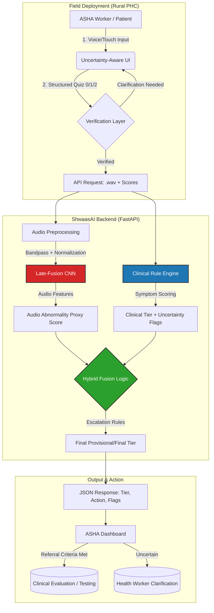

# 🫁 ShwaasAI: Multimodal TB Triage System

**ShwaasAI** is an offline-first, uncertainty-aware AI triage tool designed to help frontline health workers (ASHA workers) in rural India prioritize Tuberculosis (TB) testing. By fusing **cough acoustics** with a **clinical symptom history**, it generates a risk tier to help prioritize patients for further clinical evaluation and appropriate diagnostic testing.

---

## 🏗️ System Architecture

The system is divided into three core components:



---

## 🧠 AI/ML Pipeline & Key Metrics

### The Data & Proxy Task

Because open-source, diagnostically confirmed TB cough-audio data may be limited, the acoustic branch is evaluated on a **respiratory-abnormality proxy task** using the Coswara dataset. Confirm the exact participant count, inclusion criteria, and label mapping against the dataset version used in the experiment before publishing these figures.

- **Normal (0):** Participants assigned to the normal/healthy class under the experiment's label mapping.
- **Abnormal (1):** Participants assigned to the respiratory-abnormality proxy class under the experiment's label mapping.

**Important limitation:** These proxy labels do not establish TB infection or TB disease. Performance on this task must not be described as TB diagnostic accuracy.

### Validation Protocol

The evaluation uses participant-grouped splitting to reduce the risk of recordings from the same participant appearing in both training and evaluation partitions. If using Stratified Group K-Fold, document the number of folds, model-selection procedure, and whether the reported results are from cross-validation or a separate held-out test set.

### Performance Metrics (Audio Branch Only)

| Model / Baseline | Participant-Grouped AUROC | Interpretation |
| :--- | :---: | :--- |
| **Metadata baseline** (e.g., age / recording-quality features) | **0.610** | Checks how much discrimination may be available from non-audio metadata. |
| **Statistical baseline** (MFCC + Logistic Regression) | **0.681** | Conventional audio-feature baseline. |
| **ShwaasAI CNN** (MobileNetV2-based spectrogram model) | **0.791** | Highest AUROC among the evaluated approaches. |

These values are the reported experimental results and should be accompanied by evaluation-set details and uncertainty estimates where available. Differences in AUROC alone do not establish statistical significance or prove that the model has learned clinically meaningful biomarkers.

### Operating Point: Threshold 0.02

Based on the provided confusion matrix:

- **Sensitivity (Recall):** 72.5% (137 / 189)
- **Specificity:** 71.9% (322 / 448)
- **Precision:** 52.1% (137 / 263)
- **Accuracy:** 72.1% (459 / 637)

The threshold of `0.02` should be described as the selected operating point only if it was chosen using validation data and a predefined selection criterion. If it was selected on the final test set, re-evaluate performance with an independent test set. A low numerical threshold is not, by itself, evidence of a conservative or clinically optimal operating point.

### 📊 Generated Visuals

The following presentation charts are expected in the `/reports` folder:

- `01_training_curves.png` — training and validation loss/accuracy across epochs.
- `02_roc_pr_curves.png` — ROC and precision–recall curves, including reported AUROC 0.791 and average precision 0.625.
- `03_confusion_matrix.png` — confusion matrix at the selected threshold.
- `04_gradcam_overlay.png` — qualitative visualization of spectrogram regions contributing to the model output.
- `05_ablation_study.png` — AUROC comparison between the CNN and evaluated baselines.

Grad-CAM is a model-inspection aid; it does not prove that highlighted regions are TB biomarkers or clinically causal features. Ensure the plotted axes, color scale, labels, and captions match the actual implementation.

---

## ⚙️ API Documentation

The backend is built with **FastAPI** and is intended to run locally or on an edge server.

**Endpoint:** `POST http://127.0.0.1:8000/predict`

### Request Parameters (`multipart/form-data`)

| Field | Type | Description |
| :--- | :--- | :--- |
| `file` | File | WAV audio recording. The expected format is 16 kHz, mono; confirm the required duration against the preprocessing code. |
| `q1` | Integer | Cough duration over two weeks? (`0` = No, `1` = Yes, `2` = Unsure) |
| `q2` | Integer | Unintended weight loss? (`0` = No, `1` = Yes, `2` = Unsure) |
| `q3` | Integer | Night sweats / fever? (`0` = No, `1` = Yes, `2` = Unsure) |
| `q4` | Integer | Close TB contact? (`0` = No, `1` = Yes, `2` = Unsure) |
| `include_gradcam` | Boolean | Optional flag to request a visualization only when needed, if supported by the endpoint. |

### Example Response (Provisional Result)

```json
{
  "status": "success",
  "clinical_score": 2,
  "clinical_tier": "MODERATE",
  "uncertain_symptoms": ["unintended_weight_loss"],
  "verification": {
    "status": "clarification_required",
    "question_id": "unintended_weight_loss",
    "next_action": "ask_clarifying_question"
  },
  "audio_model": {
    "target": "audio_abnormality_proxy",
    "score": 0.0149,
    "tb_probability_validated": false
  },
  "fusion": {
    "status": "provisional",
    "tier": "MODERATE"
  },
  "recommended_action": "Resolve uncertain responses. Do not rule out TB based on audio score alone."
}
```

**Interpretation note:** `audio_model.score` is a score for the defined audio-abnormality proxy task. It must not be presented as a TB probability unless that relationship has been validated on suitable clinical reference data.

### Clarification and Result States

- If `verification.status == "clarification_required"`, show a clarification screen and do not present the result as final.
- Use a predefined, localized mapping from `question_id` to patient-friendly wording; do not display raw identifiers to patients.
- Preserve the screening/session identifier and all previously answered fields when submitting a corrected answer.
- Use the backend's documented encoding for unknown answers. Do not assume that `2` means unknown unless this is part of the API contract.
- Show the final screening summary only when the backend explicitly indicates that verification is complete and the fusion result is ready.
- Display the backend's recommended action, while ensuring it follows clinically reviewed referral rules.
- Request a Grad-CAM or other explanation payload only when supported by the API and needed by the health worker. Label the visualization according to what it actually explains.

---

## 🚀 Quick Start (For Teammates)

### 1. Prerequisites

- Python 3.10+
- `uv` (Python package and project manager)

Install `uv` using the official instructions for your operating system: <https://docs.astral.sh/uv/getting-started/installation/>.

### 2. Installation

```bash
# Clone the repository
git clone https://github.com/Kushagra-01/ShwaasAI.git
cd ShwaasAI

# Create and activate a virtual environment
uv venv

# Windows PowerShell:
.venv\Scripts\Activate.ps1

# Linux / macOS:
source .venv/bin/activate

# Install PyTorch CPU wheels (use only if this matches your deployment environment)
uv pip install torch torchaudio torchvision --index-url https://download.pytorch.org/whl/cpu

# Install project dependencies
uv pip install -r requirements.txt
```

If `requirements.txt` already pins compatible PyTorch packages, avoid installing a conflicting second version. Choose CPU or accelerator-specific dependencies based on the target hardware.

### 3. Run the API

```bash
uv run uvicorn src.api:app --reload
```

Alternatively, after activating the environment:

```bash
uvicorn src.api:app --reload
```

The API is expected to be available at `http://127.0.0.1:8000`. Open `http://127.0.0.1:8000/docs` to use FastAPI's interactive Swagger UI.

**Model weights:** Automatic downloading from Hugging Face occurs only if the code explicitly implements it and the model repository is configured. Verify this behavior before relying on it during setup.

---

## 🤝 Teammate Action Items

### 📱 App Development

1. **Build the clarification flow:** If `verification.status == "clarification_required"`, show the localized clarification question and collect a corrected answer.
2. **Handle the result state:** Display the fusion tier and recommended action only when the backend marks the result as ready.
3. **Optimize bandwidth:** Request `include_gradcam=true` only if the endpoint supports it and the health worker explicitly requests an explanation.
4. **Handle failures:** Include loading, timeout, retry, invalid-response, and offline states.
5. **Preserve traceability:** Keep response corrections and inference versions linked to the screening session, subject to consent and privacy controls.

### 🔌 Embedded / Hardware

1. **Acoustic funnel:** Evaluate the 3D-printed funnel for usability, hygiene, durability, and reduction of ambient noise without distorting the cough signal.
2. **Audio recording:** Validate the microphone pipeline for the exact sample rate, channel count, duration, clipping, and signal-quality requirements expected by preprocessing. A smartphone microphone may require resampling to 16 kHz mono.
3. **Physical demo:** Assemble and test the prototype in realistic environmental conditions, including background noise and inconsistent recording distance.

### 🎯 Presentation / Technical Validation

1. **Technical validation slide:** Present the ablation chart with the dataset, split protocol, and proxy-task label definitions.
2. **Explainability slide:** Describe Grad-CAM as qualitative model inspection, not proof of a clinical biomarker.
3. **Clinical safety slide:** Demonstrate how uncertain responses trigger clarification and how unresolved inputs remain unknown.
4. **Limitations slide:** Clearly distinguish respiratory-abnormality proxy performance from TB-specific diagnostic validation.

---

## 📂 Project Structure

```text
ShwaasAI/
├── src/
│   ├── api.py                # FastAPI endpoint
│   ├── model.py              # Audio model architecture
│   ├── gradcam.py            # Qualitative model explanation
│   ├── baseline.py            # MFCC + Logistic Regression baseline
│   └── generate_visuals.py   # Evaluation plots
├── cache/                    # Local caches; keep large/generated files out of Git
├── reports/                  # Generated charts and reports
├── data/                     # Raw data; do not commit private or restricted data
├── requirements.txt
└── README.md
```

Update this tree to match the actual repository files. Keep datasets, model weights, secrets, and any identifiable health data out of version control unless their distribution is explicitly authorized.

---

## ⚕️ Clinical Safety and Limitations

ShwaasAI is a research and screening-support prototype, not a standalone diagnostic system.

- The current acoustic evaluation is a respiratory-abnormality proxy task, not proof of TB-specific detection.
- A low audio score does not rule out TB or override concerning symptoms, exposure history, or clinical judgment.
- Clinical symptom scoring and referral thresholds require review against applicable WHO and India's National TB Elimination Programme guidance.
- Suspected TB should be evaluated through an appropriate clinical pathway and recommended diagnostic testing.
- Do not claim a clinical probability, disease stage, or confirmed diagnosis unless supported by suitable validation evidence.
- Any deployment involving patient information should implement appropriate consent, data minimization, access controls, retention policies, and applicable privacy requirements.

---

*Built to investigate uncertainty-aware, multimodal screening support for resource-constrained settings. All reported performance figures should be interpreted in the context of the stated proxy task and evaluation protocol.*
